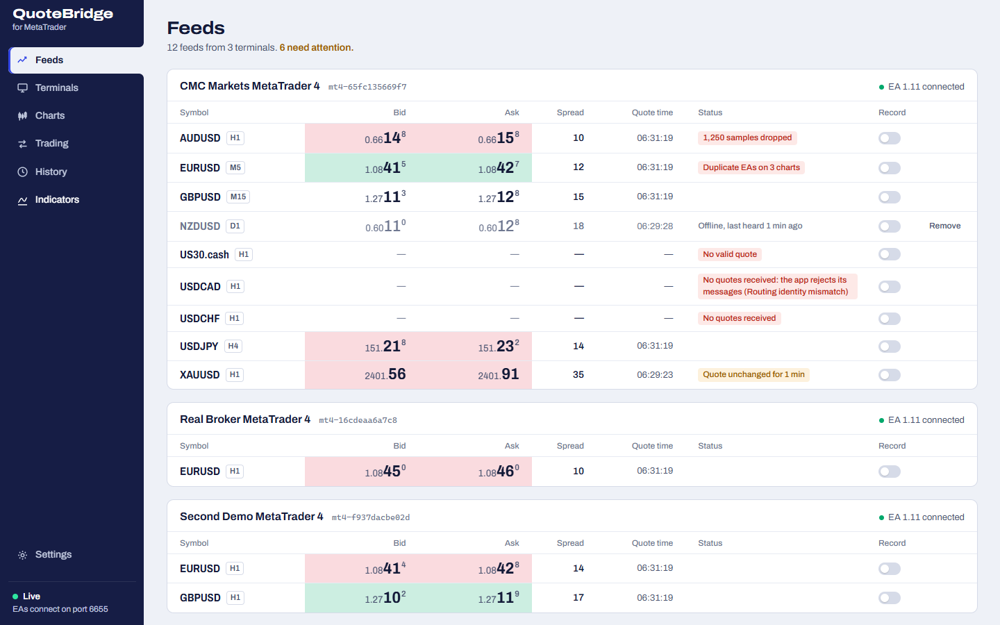
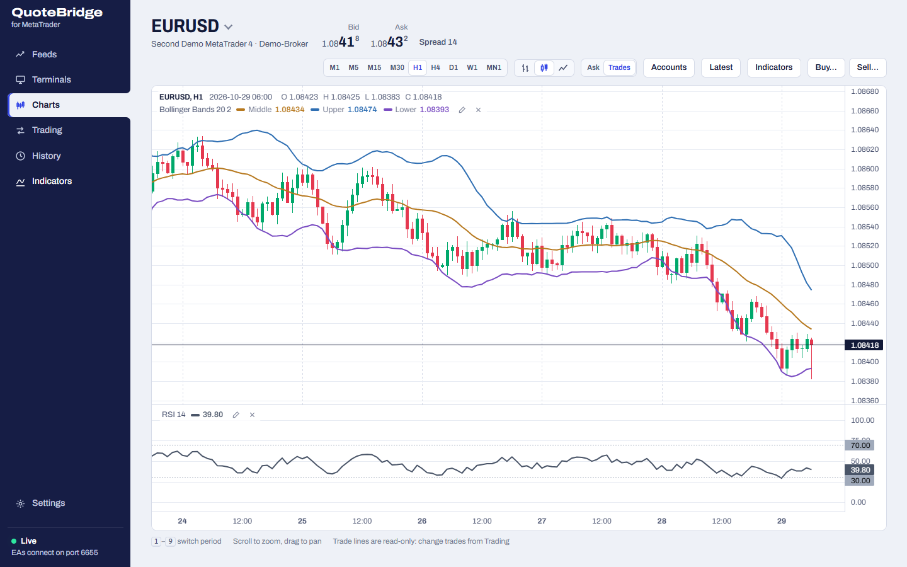

<p align="center">
  
</p>

<h1 align="center">QuoteBridge for MetaTrader</h1>

<p align="center">
  <a href="docs/install.md">install</a> ·
  <a href="docs/getting-started.md">getting started</a> ·
  <a href="docs/README.md">user manual</a> ·
  <a href="docs/rest-api.md">REST API</a> ·
  <a href="https://github.com/ross-jill-ws/quotebridge/releases/latest">download</a>
</p>

<p align="center"><b>Every MetaTrader 4 terminal on your PC, one live dashboard.</b></p>

<picture>
  <source media="(prefers-color-scheme: dark)" srcset="docs/images/feeds-dark.png">
  
</picture>

QuoteBridge is a Windows tray app. It installs a small bridge into each MetaTrader 4 terminal, then gathers every chart's
quotes in one window. It records them, draws charts with indicators, places demo trades and serves it all to your own
scripts.

- **One installer, every terminal.** On first run it finds every MT4 terminal on the computer, compiles the bridge
  EA with each terminal's own MetaEditor and installs it with one click. You apply a template and allow DLL imports;
  a checklist ticks itself off when the EA connects. → [getting started](docs/getting-started.md)
- **Is every feed alive?** Feeds are grouped by terminal, with live bid, ask and spread. Stale quotes, symbols with
  no valid quote, duplicate charts and dropped samples are each flagged on their row.
- **Charts that match MetaTrader bar for bar.** The Charts view opens with the terminal's own history, joins the live
  candles to it and follows MetaTrader's conventions: M1 to MN1, Bid label, Ask line, indicator panes.
- **Indicators as small packages.** Eight are bundled: Moving average, RSI, Bollinger Bands, MACD, AO, AC, Alligator
  and EO. Write your own in JavaScript, or convert an `.mq4` with the bundled agent skill.
  → [indicator packages](docs/indicator-packages.md)
- **Record and keep your history.** Record any market, keep a copy of the HST bars that survives MetaTrader trimming
  them, and download CSV or HST from the History page.
- **Trading across accounts.** Preview an order on any demo account, check it, then send it. Real accounts are marked
  and stay read-only until you opt in, in the app and on one chart; an unknown outcome is never sent twice. → [trading](docs/trading.md)
- **Built for scripts and agents.** A local REST API and the `mt4-quote-bridge` CLI serve markets, candles, indicator
  values, accounts, screenshots and trading requests, behind read-only or trader API keys. → [REST API](docs/rest-api.md)
- **Stays out of the way.** It runs in the tray, starts with Windows, restarts its own server after a crash, updates
  the EA in every terminal when the app updates, and never changes MetaTrader's settings or permissions.

## Install

Download `QuoteBridge-Setup-<version>-x64.exe` from the
[latest release](https://github.com/ross-jill-ws/quotebridge/releases/latest) and run it. It installs for your Windows
user only, so no administrator rights are needed.

- Windows 10 or 11, 64-bit, with MetaTrader 4 installed.
- The installer is not code-signed yet, so Windows SmartScreen may say *Windows protected your PC*: choose
  **More info › Run anyway**. Each release lists the installer's SHA-256 so you can check it first.

The [install guide](docs/install.md) covers the checksum, updates and uninstalling.

## Start it

The app opens its setup screen after installing. Tick the terminals to manage, keep **Start with Windows** on and
click **Install**. Then in each terminal:

1. Refresh the Navigator (right-click **Expert Advisors › Refresh**).
2. Open a chart and choose **Template › QuoteBridge**.
3. Press F7, and on the **Common** tab tick **Allow DLL imports**.

The terminal's checklist ticks itself off, and its quotes appear in **Feeds**.
[Getting started](docs/getting-started.md) walks through it with pictures.

<picture>
  <source media="(prefers-color-scheme: dark)" srcset="docs/images/charts-dark.png">
  
</picture>

## Docs

[Install](docs/install.md) · [getting started](docs/getting-started.md) ·
[terminals](docs/terminals.md) · [indicator packages](docs/indicator-packages.md) · [trading](docs/trading.md) ·
[trading page](docs/trading-page.md) · [command-line client](docs/cli.md) · [REST API v1](docs/rest-api.md) ·
[account protocol](docs/account-protocol.md) · [development](docs/development.md)

## Agent instructions

Agents using QuoteBridge go through the `mt4-quote-bridge` CLI and its skill: every command has `--help`, and an
agent prepares trade previews and executes one only after you approve it. To convert an MT4 indicator, an agent uses
the [mt4-indicator-to-package](.claude/skills/mt4-indicator-to-package/SKILL.md) skill in this repository.

## Development

Requires Node.js 24 on Windows.

```
npm ci
npm run dev        # fake terminals and fake EAs, dashboard in your browser
npm test
npm run package    # the Windows installer, into release/
```

[docs/development.md](docs/development.md) covers `--app`, `--real`, live reload and releasing.

## License

MIT. Bundled third-party works and their licences are listed in the app under **About › Licences**.

MetaTrader is the registered trademark of MetaQuotes Ltd. QuoteBridge for MetaTrader is an independent project, not
affiliated with or endorsed by MetaQuotes Ltd.
