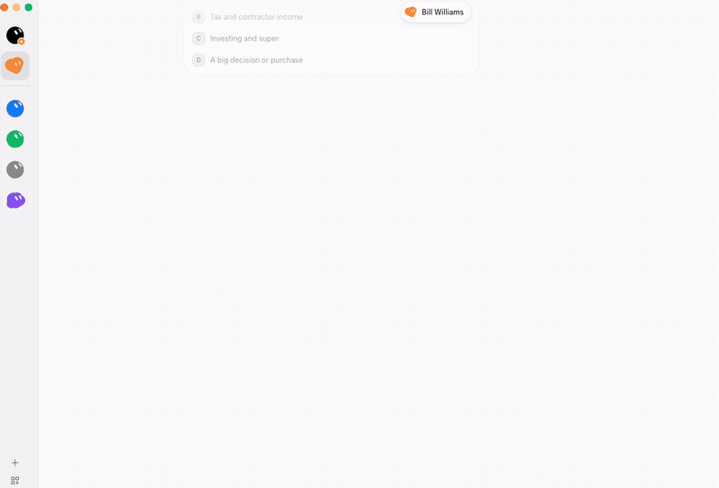

# AI agents and remote access

Talk to MetaTrader in plain words. The [mt4-quote-bridge-cli](https://github.com/ross-jill-ws/mt4-quote-bridge-cli)
skill teaches an AI agent to use QuoteBridge: ask for a gold chart, a bitcoin quote, your funds or a trade, and the
agent runs the `mt4-quote-bridge` [command-line client](cli.md) against the app for you.

The agent can run on the same PC as QuoteBridge, or anywhere else once you open a tunnel to the app with
[ngrok](#use-it-from-another-computer-with-ngrok).

## Install the skill

You need Node.js 22.12 or later on the computer where the agent runs.

**Coding agents** (Claude Code, Codex, Cursor and others): run

```
npx skills@latest add https://github.com/ross-jill-ws/mt4-quote-bridge-cli
```

**Bot apps such as Grok Bot, Dots or Muse:** paste the same line into the chat and ask the bot to install it:

```
Install this skill:
npx skills@latest add https://github.com/ross-jill-ws/mt4-quote-bridge-cli
```

The bot adds `mt4-quote-bridge-cli` to its skill library.



You don't install the CLI yourself. The first time the agent uses the skill, the agent checks for `mt4-quote-bridge`
and, when it is missing or too old, installs it from npm (`npm install --global mt4-quote-bridge-cli@latest`). Run `npx skills@latest update` to update
the skill itself.

## Connect the agent to the app

1. In the QuoteBridge app window, open **Settings › API keys** and create a key. A `readonly` key reads everything. A
   `trader` key can also take screenshots and preview and send trades. The key is shown once, so copy it.
2. Tell the agent where the app is:
   - On the same PC: the default, `http://127.0.0.1:5580`. Just ask for a quote.
   - On another computer: the ngrok address from the [next section](#use-it-from-another-computer-with-ngrok), for
     example "connect to `https://<your-address>.ngrok-free.dev`".
3. Give the agent the key when it asks. Bot apps usually keep it in their secrets store.

The agent then confirms it is signed in, and says which key it is using and whether that key can trade.

## Use it from another computer with ngrok

QuoteBridge answers only on its own PC, at `http://localhost:5580`. To reach it from a bot in the cloud, a laptop or
your phone, open a tunnel with [ngrok](https://ngrok.com/download) on the PC that runs QuoteBridge:

```
ngrok http 5580 --host-header=rewrite
```

ngrok prints a **Forwarding** address such as `https://<your-address>.ngrok-free.dev`. Give that address to the
agent, or use it with the CLI:

```
mt4-quote-bridge auth server https://<your-address>.ngrok-free.dev
mt4-quote-bridge auth login
```

- **Don't leave out `--host-header=rewrite`.** Without it, the app refuses every request through the tunnel
  (`Unexpected host`), and the CLI says the address "does not answer /api/v1/info". The app does this to protect you
  from malicious websites.
- If you changed the HTTP port in **Settings › Connection**, use that port in place of 5580.
- The tunnel lasts as long as ngrok runs. Close ngrok to stop it.

Anyone who has the address can reach the app, but every request except the version check needs an API key. Over a
tunnel, give the agent a `readonly` key unless you want it to trade. Revoke a key in **Settings › API keys** the
moment you no longer trust where it went. The tunnel serves the agent and the CLI; the app's dashboard stays in the
app window.

## What to ask

Ask in your own words. The agent picks the command, and the skill tells it what each one needs.

| Ask | The agent runs |
| --- | --- |
| "Current quote of bitcoin" | `markets quote` |
| "Show me the chart of the gold price" | `screenshot chart`: it switches your app window to that chart and sends you the picture |
| "Is everything still live?" | `screenshot feeds`, `terminals list` |
| "Last 50 H1 candles of EURUSD" | `markets candles` |
| "RSI on EURUSD H4" | `markets indicator` with a bundled or your own [indicator package](indicator-packages.md) |
| "How much margin do I have left?" | `accounts funds` |
| "What's the lot step and stop level for GOLD?" | `accounts conditions` |
| "What trades do I have open?" | `positions list`, `orders list` |
| "Buy 0.1 lot of EURUSD with a 20-pip stop" | `orders preview`, then, once you say yes, `requests execute` |
| "Move my stop loss to 1.0850" or "Close that trade" | `positions modify` or `positions close`, as a preview first |
| "Export a year of H1 gold to CSV" | `markets export` |


## Trading through an agent

The agent never trades on its own. Every new order, change or close is a **preview** first: the agent shows you the
symbol, side, lots, price and stops, and sends it only after you approve that exact preview. It sends each order
once. If the outcome is unclear, it checks what happened, and it never sends the order again.

The same rules apply as in the app: Demo trading must be on, the lot cap and slippage come from **Settings ›
Trading**, and a real account stays read-only until you opt in to [Real-account trading](trading.md#real-accounts).
Only the app window changes these settings; no agent can.
