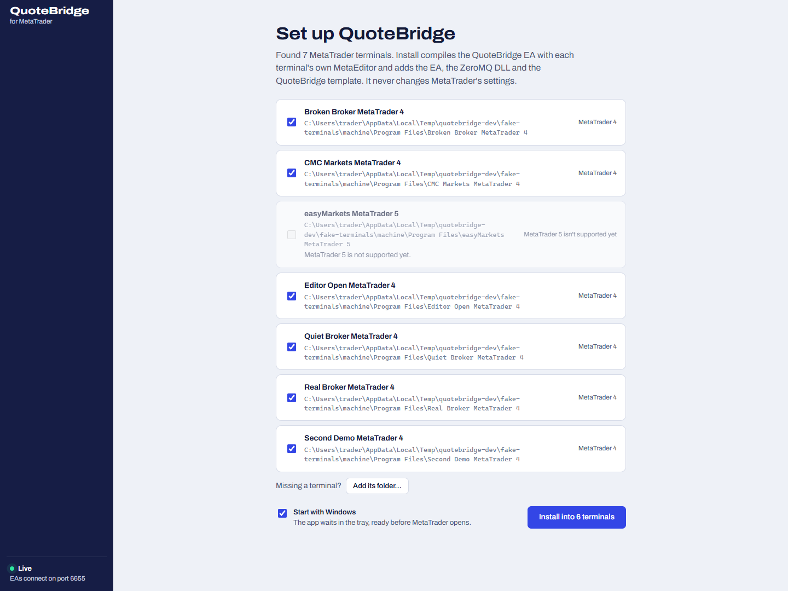
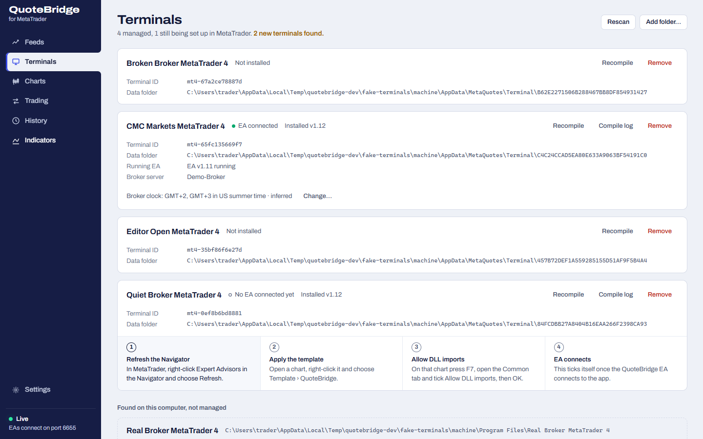
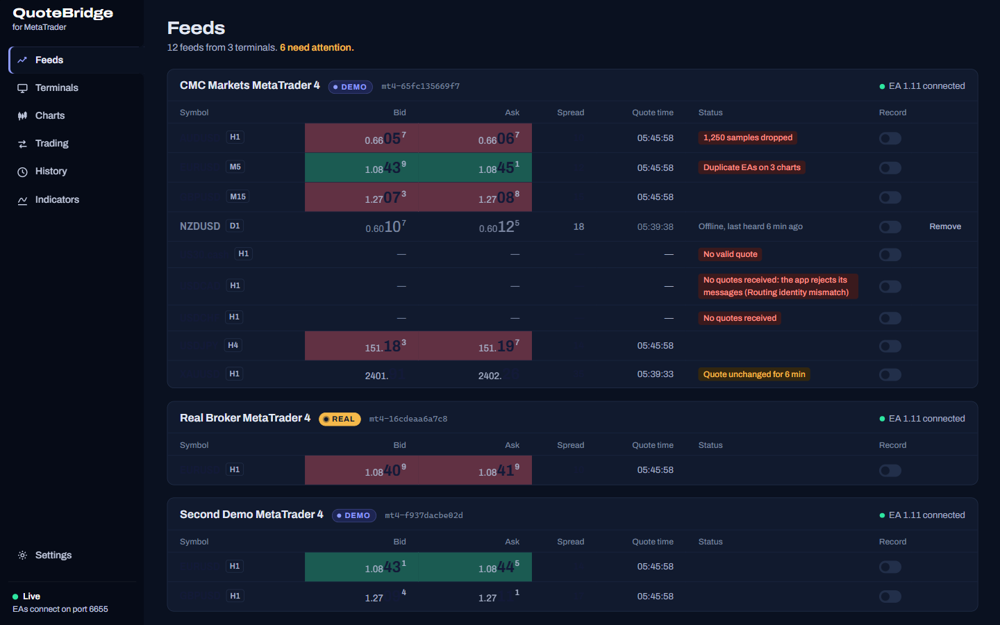
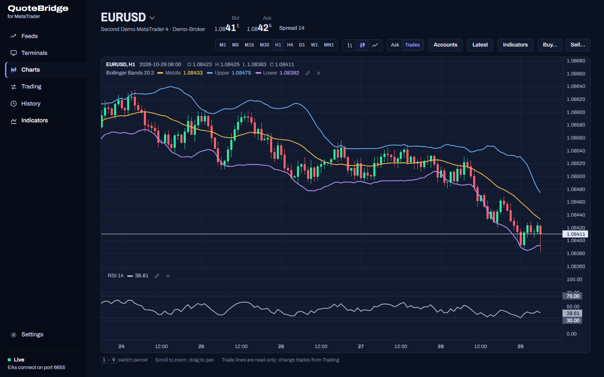
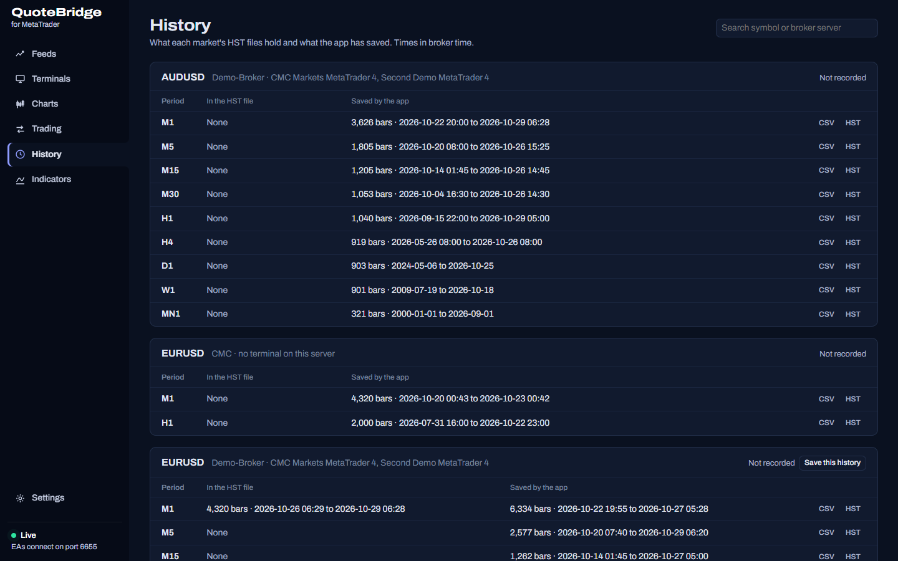
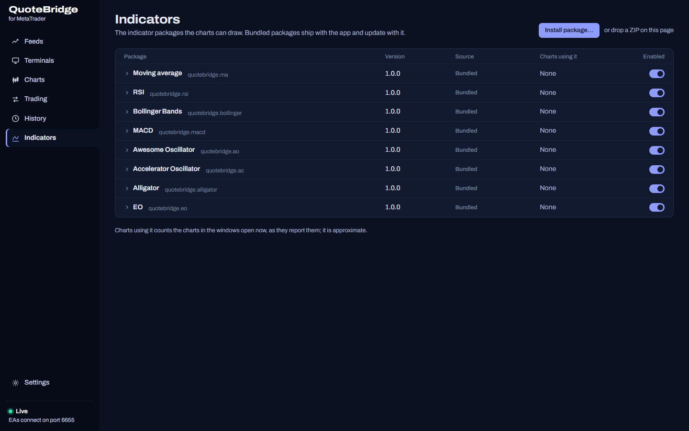
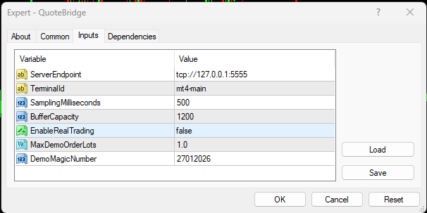
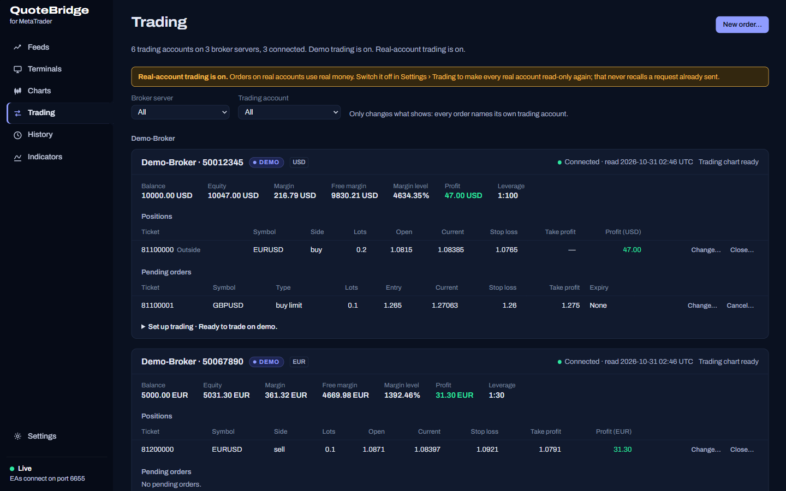

# Getting started

From a fresh install to live quotes, charts and your first script. It takes about five minutes per terminal. If the
app isn't installed yet, start with [Install](install.md).

## 1. Set up QuoteBridge

The setup screen opens after installing. It lists every MetaTrader terminal on the computer, by the name of its
installation folder, and ticks every MetaTrader 4 terminal.



- Untick any terminal you want QuoteBridge to leave alone. You can add it later from **Terminals**.
- A terminal that's missing: click **Add its folder…** and choose its installation folder. One that runs in portable
  mode shows **It runs in portable mode** to confirm it.
- Keep **Start with Windows** on, so the app waits in the tray, ready before MetaTrader opens.
- Click **Install**. For each terminal, the app compiles the QuoteBridge EA with that terminal's own MetaEditor and
  adds the EA, the ZeroMQ DLL and the QuoteBridge template. It never changes MetaTrader's settings, and never touches
  `default.tpl` or your other templates. Files from an earlier manual setup are backed up before they are replaced.

If MetaEditor is open, the app asks you to close it first, so the compile doesn't go into your open editor.

## 2. Connect each terminal

Three steps happen inside MetaTrader, and only you can do them. **Terminals** shows them as a checklist on each
terminal still being set up:



1. **Refresh the Navigator.** In MetaTrader, right-click **Expert Advisors** in the Navigator and choose **Refresh**.
2. **Apply the template.** Open a chart of a symbol you want, right-click it and choose **Template › QuoteBridge**.
3. **Allow DLL imports.** On that chart press F7, open the **Common** tab, tick **Allow DLL imports** and click OK.

The fourth step, **EA connects**, ticks itself when the app hears from the EA. Apply the template to one chart per
symbol you want to follow. AutoTrading is not needed for quotes.

## 3. Watch the feeds

**Feeds** lists every chart's quotes, grouped by terminal, with bid, ask, spread and quote time. The bid and ask cells
flash green or red on each tick.



A row is flagged when something needs you:

| Flag | Meaning |
| --- | --- |
| *Quote unchanged for …* | The quote hasn't moved for a while: the market may be closed, or the feed stalled. |
| *No valid quote* | The EA can't read a price for this symbol. |
| *Duplicate EAs on N charts* | Several charts send the same feed; remove the EA from all but one. |
| *N samples dropped* | The EA dropped quotes, for example while the app wasn't running. |
| *Offline, last heard …* | The chart's EA disconnected. **Remove** takes an old feed off the list. |

Closing the window hides the app to the tray; quotes keep flowing. Use **Quit** in the tray menu to stop it.

## 4. Open a chart

**Charts** draws any feed with MetaTrader's periods (M1 to MN1, keys 1–9), as candles, bars or a line. It opens
with the last 900 bars of the terminal's own history file, joins today's live candles onto the end, and loads more as
you scroll back. Add indicators from the **Indicators** menu; each has its own legend row and, where it needs one, its
own pane.



## 5. Record and keep history

- Turn on **Record** on a Feeds row to store every quote of that market (broker server + symbol), from whichever
  terminals supply it. **Settings › Recording** lists what is recorded, with Stop and Delete.
- **History** lists each market's periods, with what the terminal's HST file holds and what the app has saved. The
  app keeps its own copy of the bars, so history survives MetaTrader trimming its files. Download any period as CSV
  or HST.



## 6. Add your own indicators

**Indicators** lists the eight bundled packages and any you install. **Install package…** (or dropping a ZIP on the
page) adds your own. To write one, or convert an MT4 indicator, see [Indicator packages](indicator-packages.md).



## 7. Trade on demo and real accounts (optional)

QuoteBridge trades on both demo and real accounts.

- **Demo accounts** can trade from any of their charts, with no EA input to set: just turn on AutoTrading in MetaTrader.
  Switch on **Demo trading** in the app window's **Settings › Trading** before your first order.
- **Real-account trading is off by default.** A real account stays read-only until you enable it in two places:
  1. On exactly one chart of the account, press F7, open **Inputs** and set `EnableRealTrading` to `true`:

     

  2. In the app window, switch on **Real-account trading** in **Settings › Trading** and confirm its risks.

[Trading](trading.md) explains every gate, and [the Trading page](trading-page.md) the view.



## 8. Use it from scripts and agents

1. In the app window, open **Settings › API keys** and create a key: `readonly` to read, `trader` to also take
   screenshots and preview and execute trades. The key is shown once.
2. **REST API.** Call the [REST API](rest-api.md) on `http://127.0.0.1:5580/api/v1` with
   `Authorization: Bearer <key>`.
3. **CLI.** The command-line client `mt4-quote-bridge`
   ([mt4-quote-bridge-cli on GitHub](https://github.com/ross-jill-ws/mt4-quote-bridge-cli)) needs Node.js 22.12 or
   later. Install it with npm:

   ```
   npm pack github:ross-jill-ws/mt4-quote-bridge-cli
   npm install --global ./mt4-quote-bridge-cli-<version>.tgz
   ```

   Then sign in and try it:

   ```
   mt4-quote-bridge auth server       # accept the default http://127.0.0.1:5580
   mt4-quote-bridge auth login        # enter your API key
   mt4-quote-bridge accounts list
   mt4-quote-bridge markets list
   mt4-quote-bridge markets quote XAUUSD --broker EasyForex-Demo
   ```

   Use your own broker server and symbol in the last line. Every command and subcommand has `--help`; the full list
   is in [Command-line client](cli.md).

   To use it from a bot app such as Grok Bot, Muse or Dots, which cannot reach `127.0.0.1` on your PC, open an ngrok
   tunnel to the app and give the bot its address: see
   [Use it from another computer with ngrok](agents.md#use-it-from-another-computer-with-ngrok).
   [AI agents and remote access](agents.md) covers adding the CLI's skill to an agent and what to ask.

## Next

- [Terminals and feed identity](terminals.md): upgrades and portable terminals.
- [Install](install.md#update): updating and uninstalling.
- [User manual](README.md): everything else.
