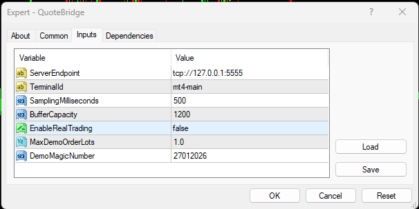
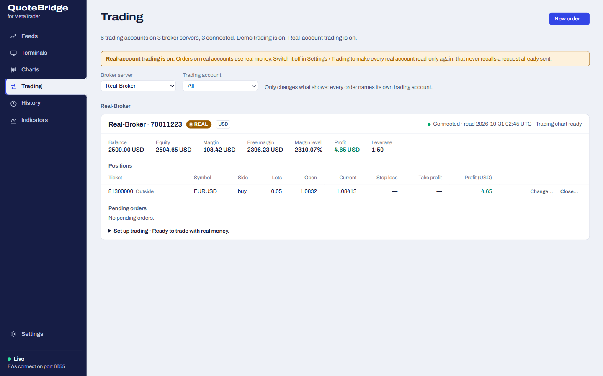

# Trading

QuoteBridge trades on **demo accounts**, across as many accounts and brokers as your terminals are signed in to.
**Real accounts** are shown and readable, and stay read-only unless you allow them to trade with two separate switches:
**Real-account trading** in the app's Settings and `EnableRealTrading` on one of the account's charts. Every view marks
each account and terminal **Demo** or **Real**. This page explains the model and the gates; the
[Trading page](trading-page.md) describes the app window's view, the [CLI](cli.md) the command line, and the
[REST API](rest-api.md#trading-requests) the contract both use.

## Accounts, not an active account

- A **trading account** is a broker server and a login. Several terminals signed in to the same account add sources,
  not accounts. Terminals change login, so an account follows whichever terminals are signed in to it now.
- A **market** is a broker server and a symbol. A trade on an account uses that account's broker server's market;
  another broker's `EURUSD` is a different market and is never substituted.
- There is **no active or default account**. Every new order names its account, and every change to an existing
  trade names the account and the ticket (tickets are unique only within an account). Filters on the Trading page and
  charts only change what you see; they never choose where a trade goes.
- Funds, positions and pending orders are read fresh from one terminal of the account. Money is in that account's
  currency, and QuoteBridge never adds up money across accounts. After a restart, an account is listed offline with
  no Funds until a terminal reconnects; nothing is shown as zero that is unknown.

## What has to be true before a trade

Every gate is checked by the app, and the account-kind and trading-chart gates again by the EA. You set MetaTrader up;
QuoteBridge never changes MetaTrader settings or permissions. Whether an account is demo or real is what MetaTrader
reports (`IsDemo()`), never a setting.

1. **Trading is on for the account's kind** in the app window's **Settings › Trading**, both off by default:
   **Demo trading** for demo accounts, **Real-account trading** for real ones. Each switch is independent: Demo trading
   never lets a real account trade. Switching Real-account trading on asks you to acknowledge its risks first. Only the
   app window can switch them, set the app's lot cap (default 1.0) or slippage (default 20 points); no API key, CLI or
   remote browser can.
2. **A trading chart for the account.** One chart of the account, its **executor**, sends every trade for the
   account, whatever the symbol; the other charts keep supplying quotes.
   - **Demo account:** any chart running EA 1.13 or later can trade; there is no input to set. With several, the app
     uses the first ready one (by terminal, then chart). An older EA trades only with its old input
     `EnableDemoTrading=true`; with none, the account shows `zero`.
   - **Real account:** exactly one chart with the EA input `EnableRealTrading=true` (EA 1.13 or later; F7 ›
     **Inputs**). It is `false` by default. With none, the account shows `real-account` and stays read-only; with more
     than one, `multiple`.

     
3. **The executor is ready:** MetaTrader is connected, **AutoTrading** is on, the EA may trade (its *Allow live
   trading* option), and the EA sees fresh server time. A chart that is enabled but not ready shows `not-ready`.
4. **The EA's cap is known and positive.** The EA input `MaxDemoOrderLots` (default 1.0, needs EA 1.12 or later) caps
   new orders at the EA, on demo and real accounts alike.

The account list (Trading page, `accounts list`) shows each account's executor state: `ready`, `zero`, `multiple`,
`not-ready` or `real-account` (a real account with no `EnableRealTrading` chart).

### Real accounts

Orders on a real account use real money: with leverage, price gaps and slippage a loss can exceed the stop loss and the
margin held. Once both switches are on, the Trading page, chart orders, `trader` API keys and the CLI can all place,
change, close and cancel the account's trades, through the same preview and execute as on demo. The order dialog marks
a real account's order, and the Trading page says while Real-account trading is on. Switching it off blocks every new
request on real accounts at once, but cannot recall one already sent.

### If an account cannot trade

The Trading page says why under the account, and the order dialog under its list of accounts:

| You see | Do this |
| --- | --- |
| *Demo trading is off.* | Switch on **Demo trading** in the app window's **Settings › Trading**. |
| *Real accounts are read-only while Real-account trading is off…* | Switch on **Real-account trading** in **Settings › Trading**, read the risks and confirm. |
| *No chart of this real account has the EA's input EnableRealTrading set to true.* | In MetaTrader, on one chart of the account, press **F7**, open **Inputs** and set `EnableRealTrading` to true. |
| *More than one chart of this account has EnableRealTrading set to true.* | Set it back to false on every chart but one. |
| *No chart of this account can trade: its EA is older than 1.13…* | Click **Recompile** on the terminal's card in **Terminals** to update its EA. |
| *The account's trading chart is not ready…* | Switch on **AutoTrading** in MetaTrader, and tick **Allow live trading** in the EA's **Common** tab (F7). |

### Lot caps and slippage

A new order's lots must fit the broker's minimum and step and be at most the **smallest** of three caps: the broker's
maximum, the EA's `MaxDemoOrderLots` and the app's lot cap. Every preview shows all three and the result. The app never
raises a cap. Closing, modifying or cancelling a larger existing trade is not refused for exceeding a cap: caps limit
new volume.

Slippage (points) is how far the price may move from the previewed price for a market order or a close. A fill is not
guaranteed.

Changing the lot cap or slippage, or switching Demo or Real-account trading, discards every preview not yet executed.
Switching either off blocks every new preview and execute on those accounts, including closes and cancels, but
**cannot recall a request already sent**. In an emergency, act in MetaTrader directly.

## Preview, execute, result

Every change goes through a **request**, with its own ID (distinct from MetaTrader's ticket):

1. **Preview.** QuoteBridge reads the account and the market's contract fresh from the executor (within five seconds),
   checks lots, caps, tick size, stop and freeze levels and margin, and answers the exact normalized order it would
   send, with limits, estimates and warnings. Nothing is sent. A preview lasts **30 seconds** and is discarded when the
   account, its executor or chart, or the trading settings change.
2. **Execute** that exact preview, explicitly. QuoteBridge checks everything again, records the request durably, then
   sends it once. If the target trade changed meanwhile, or the price moved beyond what was approved, execute refuses
   and you preview again.
3. **Result.** `succeeded` (with the ticket), `failed` (MetaTrader or the EA refused it, with its code and message),
   or `unknown`.

At most one request per account is unresolved at a time; other accounts carry on independently.

Stops are absolute (stop loss and take profit prices, which may be left out, with a warning), stop distances, or a
risk plan. Stop distances are points from the entry the preview approves, each optional: a buy's stop loss below the
entry and its take profit above, a sell's the reverse. A risk plan is a loss as an amount of the account's currency, a
percentage of the balance or a distance in points, plus a reward ratio. Both are worked out into prices rounded toward
the entry; stops that cannot be met are refused, never widened. Estimates exclude fees, swaps and slippage and are not a guaranteed loss limit.

Existing trades, including ones placed outside QuoteBridge (they carry a warning), can be modified (stop loss, take
profit; a pending order's entry and expiry), closed in full or, if pending, cancelled. There are no partial closes or
lot changes.

## Unknown outcomes and review

A request becomes **unknown** when no definitive result arrives within 20 seconds, when sending may have been
interrupted, or when the app restarts while it was being sent. It may or may not have reached the broker.

- **Never send it again,** and never preview the same trade again to find out. Read the request instead (Trading
  page, or `mt4-quote-bridge requests show <id>`). A late result still settles it.
- An unknown request blocks only its own account, previews included. To unblock it, check MetaTrader's open orders and account history,
  then **review** the request with a note of what you found (8–500 characters) and the acknowledgement that you
  checked. Review does not invent an outcome (the status stays unknown, marked reviewed) and never resends anything.
  It works with Demo and Real-account trading off.
- Requests are kept indefinitely; there is no delete.

While a terminal's request is unresolved, an EA update for that terminal waits. Quitting the app warns about
unresolved requests; after a restart they become unknown.

## Who may trade

| Surface | May |
| --- | --- |
| App window | Everything, including Settings › Trading and API keys |
| Remote browser (signed in from the app) | View, preview, execute and review; no settings or keys |
| API key `trader` | Every read, preview, execute and review |
| API key `readonly` | Every read; any change answers `403 insufficient-scope` |

Previews have no owner: any surface allowed to trade may execute a valid preview. Agents using the CLI's skill
prepare previews and execute one only after you approve that exact preview.
